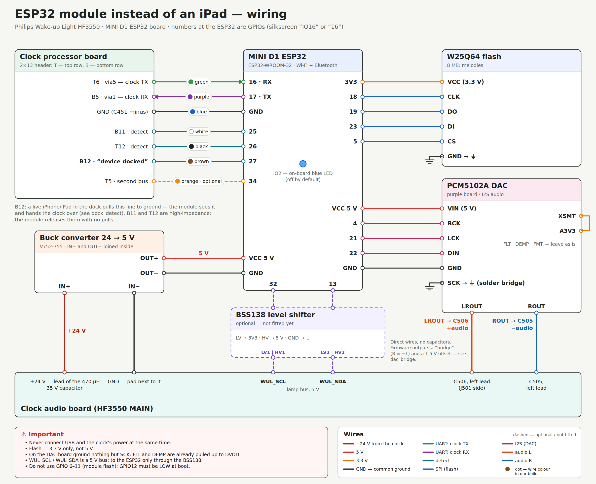

# Philips Wake-up Light HF3550 + ESP32

English · [по-русски](README.md)

The Philips Wake-up Light HF3550 is a wake-up lamp with a 30-pin iPhone/iPad dock. Almost everything it did
(alarms, sunrise, dusk, sounds, sleep tracking) was run by the Philips app on the docked device. The app has been
abandoned for years, and without it the clock can do very little.

This project puts an **ESP32 module inside the clock that pretends to be the docked device**: it does the
handshake with the clock and runs everything the iPhone used to. No phone needed any more. You control it from a
web panel on the module or from an Android app — and the clock also becomes a **Bluetooth speaker** with light music.

## Features
- **Alarms**: up to 10, weekdays, 20–40 min sunrise with adjustable brightness, sound that fades in, snooze.
  Alarms live on the module and ring without a phone or internet.
- **Sleep**: 5–60 min dusk with music, bedtime and wake-up tracking, nightly stats, a morning “how did you sleep”.
- **Sounds**: 8 melodies in external flash (bring your own mp3 — see “Melodies”), a PCM5102A DAC into the clock’s dock input.
- **Clock buttons** work as before: Light, Sound, + / −, Snooze.
- **Display**: the module sets the time (NTP, time zone) and can show your own 4-character text.
- **Bluetooth speaker**: phone music through the clock speaker, an equalizer on the display, the lamp pulsing to the beat.
- **Speaker tone**: bass cut and three bands with presets — the speaker sits without its enclosure.
- **The dock still works**: dock an iPhone/iPad and the module steps aside; undock it and the module takes over again.
- **Web panel** `http://wul.local` and an **HTTP API** ([firmware/API.md](firmware/API.md), in Russian), an **Android app**.
- **Over-the-air updates (OTA)** with automatic rollback if the new firmware fails to start.

## What you need
| Part | Purpose |
|---|---|
| An **ESP32-WROOM-32** board, D1 mini form factor (here: MINI D1 ESP32, 4 MB) | the module itself: clock link, Wi-Fi, Bluetooth |
| A **24 → 5 V** buck converter (here: V752-755, 7–26 V in) | power from the clock’s 24 V supply |
| A **W25Q64** flash board (8 MB, SPI) | melodies |
| A **PCM5102A** DAC (purple board) | sound into the clock speaker |
| Wires, soldering iron, multimeter | — |
| A **BSS138** level shifter — optional | only for lamp-bus diagnostics, not needed for normal use |

## Wiring


What to solder where and **why**, wire by wire: [docs/WIRING.en.md](docs/WIRING.en.md).
Two more diagrams: [the sound path and the “bridge”](docs/img/dac_bridge_en.png), [how the module and an iPhone/iPad share the dock](docs/img/dock_detect_en.png).

> ⚠️ **Never connect USB and the clock’s power at the same time.** Flash over USB only with the clock unplugged.
> The flash board takes 3.3 V only. Anything you do inside the clock is at your own risk.

## Build and flash
You need [PlatformIO](https://platformio.org/) (CLI or the VS Code extension).

```bash
cd firmware
bash test/run.sh                     # host tests (g++), no hardware
pio run -e esp32dev                  # build
pio run -e esp32dev -t upload        # first time — over USB (clock unplugged!)
```

After that — over Wi-Fi only, the clock can be closed:
```bash
pio run -e ota -t upload                              # wul.local, OTA password: wakeuplight
pio run -e ota -t upload --upload-port 192.168.1.50   # if wul.local is not found
```
New firmware is “on trial” for the first 45 s: if it crashes or can’t bring up the network, the bootloader rolls
back to the previous one. **Don’t switch the clock off during the first minute after an update.** In speaker mode
Wi-Fi is off — switch back to Wi-Fi first.

The web panel `firmware/ui/index.html` is embedded into the firmware automatically at build time.

## First setup
1. Switch the clock on. The module starts a hotspot **`WakeUpLight-XXXX`**, password **`wakeuplight`**.
2. Join it from your phone — a setup wizard opens (or go to `http://192.168.4.1`): language, time zone, your Wi-Fi.
3. The module restarts into your network: the panel is at `http://wul.local`, or the app finds it by itself.

If the network is gone for 90 s, the setup hotspot comes back.

## Melodies
The melodies are **not** included — they belong to Philips. Upload your own mp3 files to the external flash
(the originals work too, if you have them), named like this:

| Sound in the app | File |
|---|---|
| Birds | `chuckoo.mp3` |
| Forest | `forest_day.mp3` |
| Mountain | `cow_in_alpes.mp3` |
| Ocean | `sea_with_seagulls.mp3` |
| Piano | `sati.mp3` |
| Rooster | `rooster_and_chickens.mp3` |
| Yoga | `yoga.mp3` |
| Zen Garden | `buddha2.mp3` |

```bash
WUL_HOST=wul.local python3 tools/upload_melodies.py FOLDER_WITH_MP3
```
A missing file plays an intermittent tone instead. The flash holds 8 MB in total.

## Android app
Sources are in [android/](android/). Android 9+, Jetpack Compose. Build in Android Studio or:
```bash
cd android
./gradlew assembleRelease            # needs JDK 17 and Android SDK 35 (ANDROID_HOME or local.properties)
```
The app finds the module on the network by itself (mDNS), or you can enter its IP. In speaker mode the module’s
Wi-Fi is off — the app talks to it over Bluetooth (SPP) while the phone is connected to it as a speaker.
The UI is in Russian and English.

## Bluetooth speaker
- Turn on: **Sound ×3** on the clock, or in the app. The module restarts into speaker mode: Wi-Fi is off,
  and `WakeUpLight-XXXX` shows up in the phone’s Bluetooth list.
- Phone volume = clock volume; + / − on the clock change it on the phone too.
- Back to Wi-Fi: Sound ×3 again, the button in the app, or automatically after 10 min without a phone.
- A ringing alarm pauses the phone’s music.

## Factory reset
- **Snooze 10 times within 6 s** (not during an alarm) — the display blinks 3 times. Can be turned off in settings.
- The BOOT (IO0) button on the ESP32 board, if it has one — 10 s.
- From the web panel or the app.

The blue LED on the ESP32 board is off by default (the clock case is see-through); turn it on in settings
(“Board indicator”). The flash and DAC boards have their own power LEDs — tape over them or desolder them.

## How it works
The clock talks to the docked device over UART 19200 8N1 using iAP (Apple’s accessory protocol) and External
Accessory, with Philips frames `[len][cmd][payload]` inside. The module raises the “device inserted” (detect) lines,
goes through the iAP attach and the Philips handshake, and then answers the clock just like the original app did:
it supplies the time, switches the light and sound, and reads the buttons. Sound is analog, through the dock
input: the DAC drives it as a “bridge” (the input is differential).

```
firmware/        ESP32 firmware (PlatformIO, Arduino)
  src/core/      alarms, dusk, sleep, settings — all the “instead of the app” logic
  src/wul/       Philips frames, client and handshake, properties, buttons, display
  src/iap/       iAP / External Accessory layer
  src/net/       Wi-Fi, setup hotspot, web server, API, Bluetooth SPP, OTA
  src/audio/     DAC (I2S), mp3, Bluetooth speaker (A2DP), equalizer
  src/storage/   external flash and the melody catalog
  ui/index.html  web panel
  test/          host tests (bash test/run.sh)
  API.md         HTTP API
android/         Android app
docs/            diagrams and the wiring guide
tools/           melody upload
```

Code comments are in Russian.

## License
[MIT](LICENSE). A hobby project, not affiliated with Philips. “Philips”, “Wake-up Light”, “iPhone”, “iPad” are
trademarks of their respective owners.
