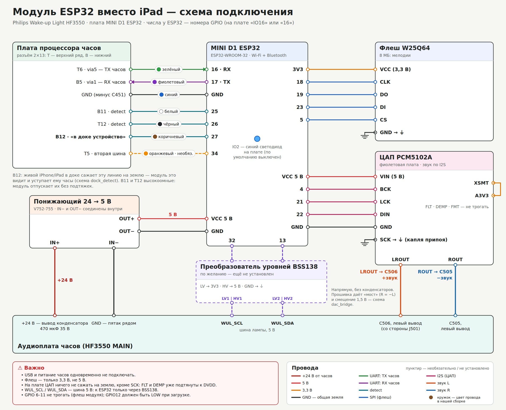

# Philips Wake-up Light HF3550 + ESP32

[English](README.en.md) · по-русски

Philips Wake-up Light HF3550 — будильник-светильник с доком для iPhone/iPad (30-pin). Почти всё в нём
(будильники, рассвет, закат, звуки, учёт сна) делало приложение Philips на устройстве в доке. Приложение давно
не поддерживается, и без него часы умеют совсем немного.

Здесь — модуль **ESP32 внутри часов, который сам изображает «устройство в доке»**: проходит рукопожатие с часами
и ведёт всё, что раньше делал iPhone. Телефон больше не нужен. Управление — веб-панель на модуле или
Android-приложение; а ещё часы становятся **Bluetooth-колонкой** со светомузыкой.

## Что умеет
- **Будильники**: до 10, дни недели, рассвет 20–40 мин с настраиваемой яркостью, звук с плавным нарастанием,
  повтор (снуз). Будильники хранятся в модуле и звенят без телефона и без интернета.
- **Сон**: закат 5–60 мин с музыкой, учёт отбоя и подъёма, статистика ночей, утренний вопрос «как спалось».
- **Звуки**: 8 мелодий во внешней флеш (свои mp3 — см. «Мелодии»), ЦАП PCM5102A на вход дока часов.
- **Кнопки часов** работают как раньше: Свет, Звук, + / −, Снуз.
- **Табло**: время ставит модуль (NTP, часовой пояс), можно вывести свою надпись из 4 знаков.
- **Bluetooth-колонка**: музыка с телефона через динамик часов, на табло — эквалайзер, лампа — в такт.
- **Звучание динамика**: срез баса и три полосы с пресетами — динамик стоит без короба.
- **Док по-прежнему работает**: вставили iPhone/iPad — модуль это видит и отпускает часы; вынули — забирает обратно.
- **Веб-панель** `http://wul.local` и **HTTP API** ([firmware/API.md](firmware/API.md)), **Android-приложение**.
- **Обновление по Wi-Fi (OTA)** с автоматическим откатом, если новая прошивка не запустилась.

## Что нужно
| Модуль | Зачем |
|---|---|
| Плата **ESP32-WROOM-32** форм-фактора D1 mini (здесь — MINI D1 ESP32, 4 МБ) | сам модуль: связь с часами, Wi-Fi, Bluetooth |
| Понижающий DC-DC **24 → 5 В** (здесь — V752-755, вход 7–26 В) | питание от блока питания часов (24 В) |
| Флеш **W25Q64** на плате (8 МБ, SPI) | мелодии |
| ЦАП **PCM5102A** (фиолетовая плата) | звук в динамик часов |
| Провода, паяльник, мультиметр | — |
| Преобразователь уровней **BSS138** — по желанию | только для диагностики шины лампы, для работы не нужен |

## Схема подключения


Что куда паять и **зачем** — по каждому проводу: [docs/WIRING.md](docs/WIRING.md).
Ещё две схемы: [путь звука и «мост»](docs/img/dac_bridge_ru.png), [как модуль и iPhone/iPad делят док](docs/img/dock_detect_ru.png).

> ⚠️ **USB и питание часов одновременно не подключать.** Прошивать по USB — только с вынутой вилкой часов.
> Флеш — только на 3,3 В. Всё внутри часов делаете на свой страх и риск.

## Сборка и прошивка
Нужен [PlatformIO](https://platformio.org/) (CLI или расширение VS Code).

```bash
cd firmware
bash test/run.sh                     # хост-тесты (g++), без железа
pio run -e esp32dev                  # сборка
pio run -e esp32dev -t upload        # первый раз — по USB (вилка часов вынута!)
```

Дальше — только по Wi-Fi, часы можно собрать:
```bash
pio run -e ota -t upload                              # wul.local, пароль OTA — wakeuplight
pio run -e ota -t upload --upload-port 192.168.1.50   # если wul.local не находится
```
Новая прошивка первые 45 с «на проверке»: если она упадёт или не поднимет сеть, загрузчик сам вернёт прошлую.
**Первую минуту после обновления часы не выключать.** В режиме колонки Wi-Fi выключен — сначала вернуть Wi-Fi.

Веб-панель `firmware/ui/index.html` встраивается в прошивку сама при сборке.

## Первая настройка
1. Включите часы. Модуль поднимет точку доступа **`WakeUpLight-XXXX`**, пароль **`wakeuplight`**.
2. Подключитесь к ней с телефона — откроется мастер (или зайдите на `http://192.168.4.1`):
   язык, часовой пояс, ваша сеть Wi-Fi.
3. Модуль перезагрузится в вашу сеть: панель — `http://wul.local`, или приложение найдёт его само.

Если сеть пропадёт на 90 с, точка настройки поднимется снова.

## Мелодии
Мелодий в репозитории **нет** — это материалы Philips. Залейте во внешнюю флеш свои mp3
(подойдут и оригинальные, если они у вас есть) с такими именами:

| Звук в приложении | Файл |
|---|---|
| Birds | `chuckoo.mp3` |
| Forest | `forest_day.mp3` |
| Mountain | `cow_in_alpes.mp3` |
| Ocean | `sea_with_seagulls.mp3` |
| Piano | `sati.mp3` |
| Rooster | `rooster_and_chickens.mp3` |
| Yoga | `yoga.mp3` |
| Zen Garden | `buddha2.mp3` |

```bash
WUL_HOST=wul.local python3 tools/upload_melodies.py ПАПКА_С_MP3
```
Нет файла — вместо мелодии звучит прерывистый тон. Всего во флеш 8 МБ.

## Android-приложение
Исходники — [android/](android/). Android 9+, Jetpack Compose. Сборка — Android Studio или:
```bash
cd android
./gradlew assembleRelease            # нужны JDK 17 и Android SDK 35 (ANDROID_HOME или local.properties)
```
Приложение находит модуль в сети само (mDNS), можно ввести IP. В режиме колонки Wi-Fi у модуля выключен —
приложение управляет им по Bluetooth (SPP), к телефону он подключён как колонка.

## Bluetooth-колонка
- Включить: **«Звук» ×3** на часах или в приложении. Модуль перезагрузится в режим колонки:
  Wi-Fi выключен, в списке Bluetooth телефона — `WakeUpLight-XXXX`.
- Громкость телефона = громкость часов; +/− на часах меняют её и на телефоне.
- Вернуть Wi-Fi: «Звук» ×3 ещё раз, кнопка в приложении или само — через 10 мин без телефона.
- Звонок будильника ставит музыку телефона на паузу.

## Сброс к заводским
- **«Снуз» 10 раз за 6 с** (не во время будильника) — табло мигнёт 3 раза. Можно выключить в настройках.
- Кнопка BOOT (IO0) на плате ESP32, если она есть, — 10 с.
- Из веб-панели или приложения.

Синий светодиод на плате ESP32 по умолчанию не светит (корпус часов прозрачный); включается в настройках
(«Индикатор на плате»). У плат флеш и ЦАП свои светодиоды питания — их можно заклеить или выпаять.

## Как это устроено
Часы говорят с устройством в доке по UART 19200 8N1 через iAP (протокол аксессуаров Apple) и External Accessory —
внутри идут кадры Philips `[len][cmd][payload]`. Модуль поднимает линии «устройство вставлено» (detect),
проходит iAP-attach и рукопожатие Philips, а дальше отвечает часам так же, как оригинальное приложение:
отдаёт время, включает свет и звук, читает кнопки. Звук — аналоговый, через вход дока: ЦАП подаёт его
«мостом» (вход дифференциальный).

```
firmware/        прошивка ESP32 (PlatformIO, Arduino)
  src/core/      будильники, закат, сон, настройки — вся логика «вместо приложения»
  src/wul/       кадры Philips, клиент и рукопожатие, свойства, кнопки, табло
  src/iap/       слой iAP / External Accessory
  src/net/       Wi-Fi, точка настройки, веб-сервер, API, Bluetooth SPP, OTA
  src/audio/     ЦАП (I2S), mp3, Bluetooth-колонка (A2DP), эквалайзер
  src/storage/   внешняя флеш и каталог мелодий
  ui/index.html  веб-панель
  test/          хост-тесты (bash test/run.sh)
  API.md         HTTP API
android/         приложение для Android
docs/            схемы и описание подключения
tools/           заливка мелодий
```

## Лицензия
[MIT](LICENSE). Проект любительский и не связан с Philips. «Philips», «Wake-up Light», «iPhone», «iPad» —
товарные знаки их владельцев.
