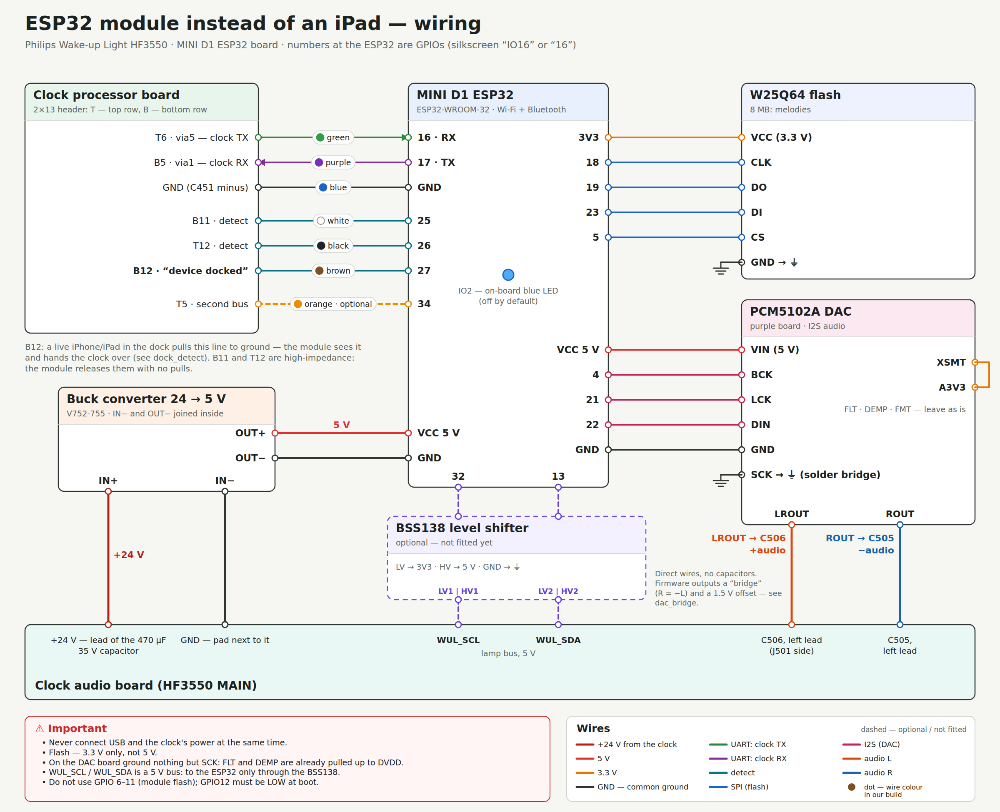

# Wiring: what goes where and why

English · [по-русски](WIRING.md)

There are two boards inside the HF3550 you need to solder to:
- the **audio board** (marked HF3550 MAIN) — with the J501 dock connector, the 470 µF 35 V input capacitor and the amplifier;
- the **clock processor board** — with the 2×13 board-to-board connector (T is the top row, B the bottom row).

Numbers on the ESP32 side are GPIOs (the board says “IO16” or just “16”). All grounds — every board and the clock — are common.

## 1. Power: the clock’s 24 V → 5 V
| From | To | Why |
|---|---|---|
| +24 V — a lead of the 470 µF 35 V capacitor on the audio board | buck IN+ | the clock’s power supply gives 24 V; the capacitor absorbs the spike when the plug goes in — the buck only has 2 V of input headroom (up to 26 V) |
| GND — the pad next to the capacitor | IN− | common ground with the clock |
| OUT+ (5 V) | ESP32 VCC (5V) and DAC VIN | the ESP32 and the DAC run from 5 V through their own regulators |
| OUT− | ESP32 GND and DAC GND | the buck’s IN− and OUT− are joined internally |

Before you connect the ESP32, power the clock and **check 5 V at the buck output** — and check the 24 V polarity
with a multimeter before soldering.

## 2. Talking to the clock: UART and the detect lines
All of these are on the board-to-board connector of the clock processor board.

| Clock | ESP32 | Why |
|---|---|---|
| T6 · via5 — clock TX | 16 (RX) | the clock talks to the dock over UART 19200 8N1 at 3.3 V — direct, no level shifting |
| B5 · via1 — clock RX | 17 (TX) | the module’s replies |
| GND (C451 minus) | GND | UART ground close to the signals |
| B11 · detect | 25 | three “device inserted” lines: the module raises them and the clock calls the device up |
| T12 · detect | 26 | — |
| B12 · “device in dock” | 27 | a docked iPhone/iPad pulls it to ground — that’s how the module sees a live device in the dock, releases the lines and hands the clock over |
| T5 · second bus | 34 | **optional**: listen-only, for diagnostics |

When it lets go of the clock, the module leaves B11 and T12 floating (they are high-impedance — a pull resistor would
“hide” a docked device) and B12 pulled up. How it works: [dock_detect](img/dock_detect_en.png).

## 3. W25Q64 flash: melodies
| W25Q64 | ESP32 | Why |
|---|---|---|
| VCC | 3V3 | **3.3 V only**, not 5 V |
| GND | GND | |
| CLK | 18 | SPI (VSPI) |
| DO | 19 | |
| DI | 23 | |
| CS | 5 | |

The ESP32’s own flash (4 MB) has no room for the melodies — they need external flash.

## 4. PCM5102A DAC: sound into the clock speaker
| PCM5102A | To | Why |
|---|---|---|
| VIN | 5 V (buck OUT+) | the board has its own 3.3 V regulators |
| GND | GND | |
| BCK | ESP32 4 | I2S |
| LCK | ESP32 21 | |
| DIN | ESP32 22 | |
| SCK | GND — a solder blob on the board | no separate master clock: the DAC derives it from BCK |
| XSMT | A3V3 | otherwise the DAC stays muted |
| FLT, DEMP, FMT | **leave alone** | on these boards they are already tied by traces; a wire to ground shorts the DAC supply |
| **LROUT** | **C506, left lead** (J501 side), audio board | “+sound” |
| **ROUT** | **C505, left lead**, audio board | “−sound” |

**Why a “bridge” and no capacitors.** The clock’s dock input is differential: the speaker gets C506 − C505.
The melodies are mono — the same signal on both leads cancels itself out (quiet and distorted). So the firmware
outputs L = sound, R = −sound plus a 1.5 V DC offset — that’s why the wires go direct, without coupling
capacitors. Details: [dac_bridge](img/dac_bridge_en.png).

Before soldering, power a new DAC board and measure FLT/DEMP/FMT/XSMT — batches differ.
The C506/C505 pads are tiny: secure the wires with a drop of hot glue 3–5 mm from the joint.

## 5. Lamp bus (optional)
WUL_SCL / WUL_SDA on the audio board are the lamp controller’s 5 V bus. Connect them to the ESP32 (32 = SCL,
13 = SDA) **only through a BSS138 level shifter** (LV → 3V3, HV → 5 V). It is for diagnostics only — the module
controls the lamp through the clock protocol.

## Don’t
- **Don’t connect USB and the clock’s power at the same time.** Flash over USB with the clock unplugged.
- Don’t touch GPIO 6–11 (the module’s internal flash); GPIO12 must be LOW at boot; 0, 2, 15 are boot-mode pins.
  GPIO2 is the board’s blue LED (off by default).
- Don’t feed 5 V to the flash. Don’t ground any DAC pin except SCK.

## Assembly order
1. Flash the ESP32 over USB before installing it (with the clock unplugged).
2. Buck: solder it to 24 V, check 5 V at the output — only then connect the ESP32.
3. UART and detect: `GET http://wul.local/api/link` → `state` 20 means the module is talking to the clock.
4. Flash: `POST /api/melodies` with body `{}` lists the catalog; upload the melodies (`tools/upload_melodies.py`).
5. DAC: press “Sound” in the web panel → the melody should play from the clock speaker.
6. From now on, update the firmware over Wi-Fi only — the clock can be closed.
