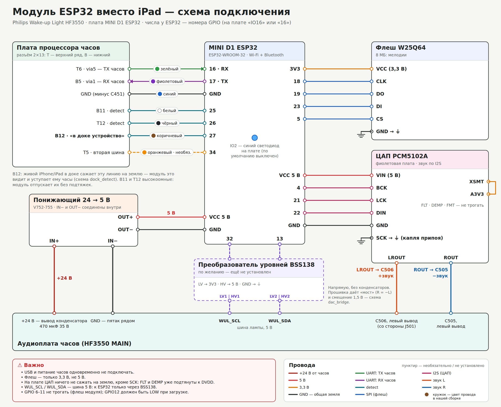

# Подключение: что, куда и зачем

[English](WIRING.en.md) · по-русски

Внутри HF3550 две платы, к которым нужно припаяться:
- **аудиоплата** (надпись HF3550 MAIN) — с разъёмом дока J501, входным конденсатором 470 мкФ 35 В и усилителем;
- **плата процессора часов** — с межплатным разъёмом 2×13 (T — верхний ряд, B — нижний).

Номера у ESP32 — это GPIO (на плате подписаны «IO16» или просто «16»). Земли всех плат и часов — общие.

## 1. Питание: 24 В часов → 5 В
| Откуда | Куда | Зачем |
|---|---|---|
| +24 В — вывод конденсатора 470 мкФ 35 В на аудиоплате | IN+ понижающего | блок питания часов даёт 24 В; конденсатор гасит бросок при включении вилки — запас понижающего по входу (до 26 В) всего 2 В |
| GND — пятак рядом с конденсатором | IN− | общая земля с часами |
| OUT+ (5 В) | VCC (5V) ESP32 и VIN ЦАП | ESP32 и ЦАП питаются от 5 В через свои стабилизаторы |
| OUT− | GND ESP32 и GND ЦАП | IN− и OUT− у понижающего соединены внутри |

Перед тем как подключать ESP32, включите часы и **проверьте 5 В на выходе понижающего**, а полярность
24 В — мультиметром ещё до пайки.

## 2. Связь с часами: UART и линии detect
Всё — на межплатном разъёме платы процессора часов.

| Часы | ESP32 | Зачем |
|---|---|---|
| T6 · via5 — TX часов | 16 (RX) | часы говорят с доком по UART 19200 8N1, уровни 3,3 В — напрямую, без преобразователей |
| B5 · via1 — RX часов | 17 (TX) | ответы модуля |
| GND (минус C451) | GND | земля UART рядом с сигналом |
| B11 · detect | 25 | три линии «устройство вставлено»: модуль поднимает их, и часы зовут устройство на связь |
| T12 · detect | 26 | — |
| B12 · «в доке устройство» | 27 | вставленный iPhone/iPad сажает её на землю — так модуль видит, что в доке живое устройство, отпускает линии и уступает ему часы |
| T5 · вторая шина | 34 | **по желанию**: только прослушка для диагностики |

Отпуская часы, модуль оставляет B11 и T12 без подтяжек (узлы высокоомные — подтяжка «спрятала» бы
вставленное устройство), а B12 — с подтяжкой вверх. Как это работает — [dock_detect](img/dock_detect_ru.png).

## 3. Флеш W25Q64: мелодии
| W25Q64 | ESP32 | Зачем |
|---|---|---|
| VCC | 3V3 | **только 3,3 В**, не 5 В |
| GND | GND | |
| CLK | 18 | SPI (VSPI) |
| DO | 19 | |
| DI | 23 | |
| CS | 5 | |

Во внутренней флеш ESP32 (4 МБ) места под мелодии нет — им нужна внешняя.

## 4. ЦАП PCM5102A: звук в динамик часов
| PCM5102A | Куда | Зачем |
|---|---|---|
| VIN | 5 В (OUT+ понижающего) | у платы свои стабилизаторы 3,3 В |
| GND | GND | |
| BCK | ESP32 4 | I2S |
| LCK | ESP32 21 | |
| DIN | ESP32 22 | |
| SCK | GND — капля припоя на плате | без отдельной тактовой: ЦАП берёт такт из BCK |
| XSMT | A3V3 | иначе ЦАП стоит «на паузе» |
| FLT, DEMP, FMT | **не трогать** | на этих платах они уже подтянуты дорожками; провод на землю закоротит питание ЦАП |
| **LROUT** | **C506, левый вывод** (со стороны J501), аудиоплата | «+звук» |
| **ROUT** | **C505, левый вывод**, аудиоплата | «−звук» |

**Почему «мостом» и без конденсаторов.** Вход дока у часов дифференциальный: на динамик идёт разность
C506 − C505. Мелодии моно — одинаковый сигнал на обоих выводах вычитается сам из себя (тихо и с хрипом).
Поэтому прошивка выдаёт L = звук, R = −звук и ещё постоянное смещение 1,5 В — оттого провода идут напрямую,
без разделительных конденсаторов. Подробно — [dac_bridge](img/dac_bridge_ru.png).

Перед пайкой включите новую плату ЦАП и померьте уровни на FLT/DEMP/FMT/XSMT — партии отличаются.
Пятаки C506/C505 маленькие: закрепите провода каплей термоклея в 3–5 мм от пайки.

## 5. Шина лампы (по желанию)
WUL_SCL / WUL_SDA на аудиоплате — шина 5 В контроллера лампы. Подключать к ESP32 (32 = SCL, 13 = SDA)
**только через преобразователь уровней BSS138** (LV → 3V3, HV → 5 В). Нужна лишь для диагностики,
лампой модуль управляет по протоколу часов.

## Чего не делать
- **Не подключать USB и питание часов одновременно.** Прошивать по USB — с вынутой вилкой часов.
- Не трогать GPIO 6–11 (внутренняя флеш модуля); GPIO12 должен быть LOW при загрузке; 0, 2, 15 — выводы
  режима загрузки. GPIO2 — синий светодиод платы (по умолчанию выключен).
- Не подавать на флеш 5 В. Не сажать на землю выводы ЦАП, кроме SCK.

## Порядок сборки
1. Прошить ESP32 по USB ещё до установки (часы при этом обесточены).
2. Понижающий: припаять к 24 В, проверить 5 В на выходе — и только потом подключать ESP32.
3. UART и detect: `GET http://wul.local/api/link` → `state` 20 — модуль на связи с часами.
4. Флеш: `POST /api/melodies` с телом `{}` показывает каталог; залить мелодии (`tools/upload_melodies.py`).
5. ЦАП: в веб-панели «Звук» → мелодия должна звучать из динамика часов.
6. Дальше прошивку обновлять только по Wi-Fi, часы можно собирать.
